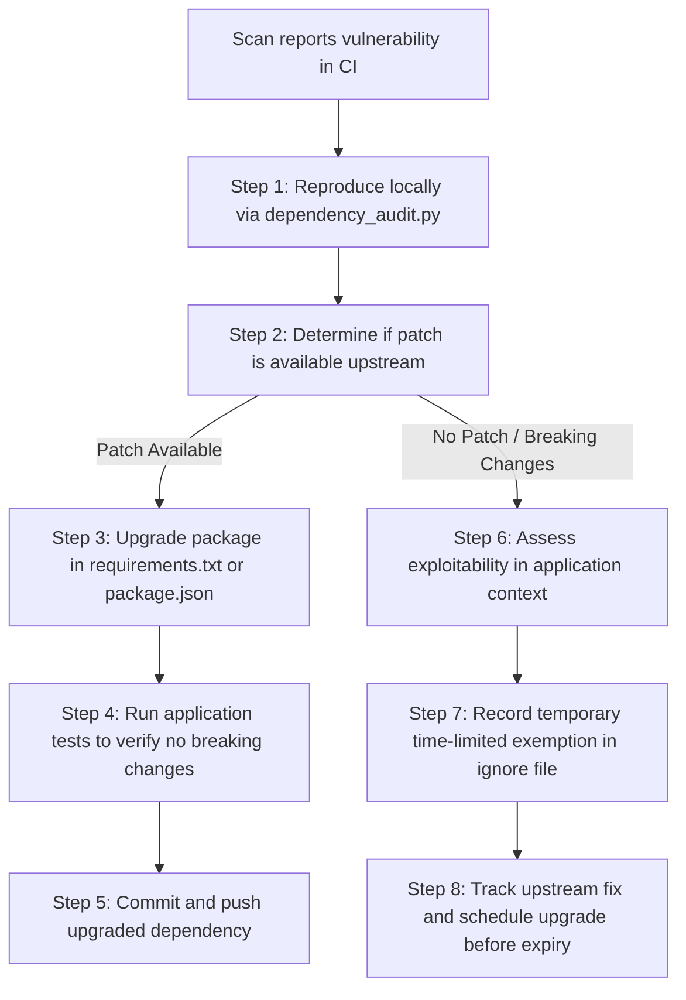

# Dependency Vulnerability Management Guide

This document establishes the official policy and standard operating procedures for automated dependency vulnerability scanning, triage, remediation, and temporary exemptions in the **AI Campus Placement Agent** project.

---

## 1. Overview & Architecture

The application relies on packages in both the **Python** ecosystem (`requirements.txt`) and **JavaScript** ecosystem (`package.json` / `package-lock.json`). Dependencies are continuously monitored for security advisories across multiple vulnerability databases:

| Ecosystem | Manifest File | Primary Audit Tool | Upstream Database |
| :--- | :--- | :--- | :--- |
| **Python** | `requirements.txt` | `pip-audit` / `utils/dependency_audit.py` | PyPA Advisory DB, OSV (Open Source Vulnerabilities) |
| **JavaScript** | `package.json`, `package-lock.json` | `npm audit` / `utils/dependency_audit.py` | GitHub Security Advisory Database (GHSA), CVE |

Automated scanning is integrated directly into continuous integration workflows:
- **Pull Requests**: Every pull request targeting `main` executes `dependency-vulnerability-scan` in `.github/workflows/ci.yml`.
- **Scheduled CI**: Runs weekly every Monday at 04:00 UTC (`0 4 * * 1`) to discover newly published CVEs for existing code.
- **Automated Update PRs**: Dependabot (`.github/dependabot.yml`) creates grouped weekly update pull requests for Python (`pip`), JavaScript (`npm`), and GitHub Actions.

---

## 2. CI Reports & Pull Request Visibility

### GitHub Step Summary ($GITHUB_STEP_SUMMARY)
When the audit runs in CI, `utils/dependency_audit.py` generates a structured Markdown report published directly to the job's **GitHub Step Summary**:

1. **Overall Status**: Marked as `✅ PASSED` or `❌ FAILED`.
2. **Python Summary**:
   - Number of unhandled vulnerabilities.
   - Number of active exemptions loaded from `.pip-audit-ignore.yml`.
   - Itemized table listing package name, installed version, advisory ID (e.g., `PYSEC-*`, `CVE-*`), fixed versions, and description.
3. **JavaScript Summary**:
   - Number of production vulnerabilities meeting or exceeding the audit threshold.
   - Number of development-only or low-severity warnings filtered from blocking thresholds.
   - Number of active exemptions loaded from `.npm-audit-ignore.json`.
   - Itemized table with package name, severity (`HIGH` / `CRITICAL`), advisory ID, and patch availability.

---

## 3. Development-Only Warnings Policy

### Why Dev Warnings Are Omitted from Blocking Thresholds
Many repositories experience broken CI pipelines due to advisory notices in development-time tools (such as test runners, linters, code formatters, or local compilers). These packages:
- Are **never** bundled or deployed to end-user production environments.
- Do not process external untrusted user input in production runtime.
- Often generate low- or moderate-severity informational warnings for CLI scripts.

To prevent build pipeline blockage without sacrificing production security:
1. **Production Auditing (`--omit=dev`)**: The JavaScript audit uses `--omit=dev` to scan runtime dependencies.
2. **High/Critical Threshold (`--audit-level=high`)**: The build will only fail for actionable high- or critical-severity production vulnerabilities.
3. **Explicit Logging & Transparency**: The CI summary explicitly lists the count of filtered dev-only warnings with guidance on how maintainers can inspect them locally.

---

## 4. Maintainer Triage & Remediation Workflow

When a vulnerability is reported in a pull request or scheduled scan, follow this systematic process:



### Step 1: Reproduce Findings Locally
Run the dependency audit script locally from your workspace root:

```bash
# Audit both Python and JavaScript dependencies
python utils/dependency_audit.py

# Or audit Python only
python utils/dependency_audit.py --skip-npm

# Or audit JavaScript only
python utils/dependency_audit.py --skip-python

# To inspect full JavaScript dev warnings locally (without omitting dev)
npm audit
```

### Step 2: Assess Severity & Impact
Review the advisory details:
- **Advisory ID**: Search the identifier on [OSV.dev](https://osv.dev/) or [GitHub Advisory Database](https://github.com/advisories).
- **Attack Vector**: Is the vulnerable component reachable by end-user input in our Flask routes or frontend scripts?
- **Remediation**: Check whether a newer version resolves the vulnerability.

### Step 3: Upgrade Vulnerable Packages

#### For Python Packages
1. Check the latest released version:
   ```bash
   pip index versions <package-name>
   # or
   pip list --outdated
   ```
2. Upgrade the package locally:
   ```bash
   pip install --upgrade <package-name>
   ```
3. Update the version constraint in `requirements.txt`:
   ```text
   # Update the requirement line
   <package-name>>=<new-version>
   ```
4. Verify application functionality and run test suite.

#### For JavaScript Packages
1. Check available updates:
   ```bash
   npm outdated
   ```
2. Update the package:
   ```bash
   npm update <package-name>
   # or install latest release
   npm install <package-name>@latest
   ```
3. For automatic patch upgrades of production packages:
   ```bash
   npm audit fix --omit=dev
   ```
4. Commit updated `package.json` and `package-lock.json`.

---

## 5. Temporary Exemption Policy (Handling Unfixable Advisories)

When an advisory is reported but cannot be resolved immediately (e.g., the library author has not published a fix, or upgrading introduces major breaking changes requiring a migration), maintainers may record a **strictly-governed temporary exemption**.

### Exemption Files
- **Python**: `.pip-audit-ignore.yml`
- **JavaScript**: `.npm-audit-ignore.json`

### Mandatory Entry Schema
Every entry in both ignore files **strictly requires** all four fields:
1. `id`: Exact vulnerability ID (`PYSEC-*`, `CVE-*`, or `GHSA-*`).
2. `package`: Affected library name.
3. `reason`: A detailed, technical explanation stating:
   - Why the package cannot be updated immediately.
   - Why the vulnerability is mitigated or not exploitable in our architecture.
   - What migration or tracking issue is monitoring the upstream fix.
4. `expiry`: Strict expiration date in `YYYY-MM-DD` format (maximum allowed window: **90 days** from waiver creation).

#### Python Example (`.pip-audit-ignore.yml`)
```yaml
ignored_advisories:
  - id: "PYSEC-2026-2151"
    package: "flask"
    reason: "Upgrading to Flask 3.1.3 requires updating dependencies currently pinned for WSGI compatibility."
    expiry: "2026-12-31"
```

#### JavaScript Example (`.npm-audit-ignore.json`)
```json
{
  "description": "NPM Dependency Vulnerability Allow-List & Temporary Exceptions (#649)",
  "version": 1,
  "ignored_advisories": [
    {
      "id": "GHSA-xxxx-yyyy-zzzz",
      "package": "example-pkg",
      "reason": "Vulnerability affects server-side SSR which is not used; client analytics bundle is isolated.",
      "expiry: "2026-12-31"
    }
  ]
}
```

### Automatic Expiration Enforcement
- The CI audit script (`utils/dependency_audit.py`) validates the date of every exemption on every CI run.
- If any exemption lacks a `reason` or `expiry`, the build fails immediately.
- Once the date passes (`expiry < today`), the waiver **expires automatically** and the build fails until:
  1. The library is updated and the entry removed, or
  2. A new PR is reviewed and merged renewing the justification with an updated expiration date.

---

## 6. Dependabot Review Checklist

Dependabot submits automated pull requests every Monday. When reviewing Dependabot PRs:
- [ ] Check CI build status for green tests and clean dependency audits.
- [ ] Read the package changelog / release notes attached in the Dependabot PR description.
- [ ] Ensure no unexpected transitive dependency conflicts are introduced.
- [ ] Approve and merge using Squash & Merge to keep git history clean.

---

## 7. Security Contacts & Support

For questions or private vulnerability disclosures, consult [`SECURITY.md`](file:///SECURITY.md) or submit a private advisory via [GitHub Security Advisories](https://github.com/deepikagandla74/ai-campus-placement-agent/security/advisories/new).
