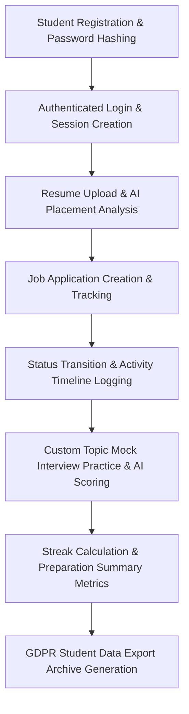

# End-to-End (E2E) Student Workflow Testing Guide

This guide details the automated End-to-End test suite (`tests/test_e2e_student_workflow.py`) validating all user journeys across the AI Campus Placement Agent platform.

## Test Suite Architecture

The E2E test suite simulates complete student lifecycles from fresh registration through interview drill-down and graduation placement tracking.



## Scenarios Covered

1. **Registration & Cryptographic Security**:
   - Validates that user accounts are created with password hashing (`generate_password_hash`).
   - Ensures duplicate email registrations are prevented.

2. **Session Handling & Authentication Context**:
   - Validates login authentication and session cookies.
   - Tests secure authenticated access to student portals.

3. **Resume Analysis & Multi-Role Evaluation**:
   - Generates placement match score, matched skills, and skill gaps.
   - Verifies actionable learning roadmaps and interview questions.

4. **Job Application Management & Activity Timeline**:
   - Validates creation of job application tracking records.
   - Verifies status transitions (`Applied` -> `Online Assessment` -> `Interview Scheduled`).
   - Validates immutable chronological timeline logging for application events.

5. **AI Interview Practice Drills**:
   - Tests question generation across technical topics (`dsa`, `system_design`, `database`).
   - Evaluates student response scoring, feedback generation, and topic persistence.

6. **Multi-Tenant Privacy & Data Isolation**:
   - Confirms that unauthorized students are strictly barred from reading, updating, or deleting other students' applications, notes, or timelines.

7. **Data Export Package**:
   - Tests generation of sanitized data manifests excluding passwords, private keys, and tokens.
   - Validates ZIP archive packaging with domain-separated JSON files.

## Running the E2E Test Suite Locally

To run the complete E2E workflow tests:

```bash
# Execute full E2E test suite
pytest tests/test_e2e_student_workflow.py -v --no-cov

# Execute alongside all unit test suites
pytest -v --no-cov
```
