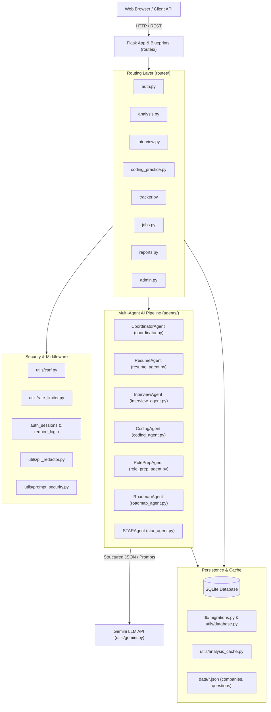
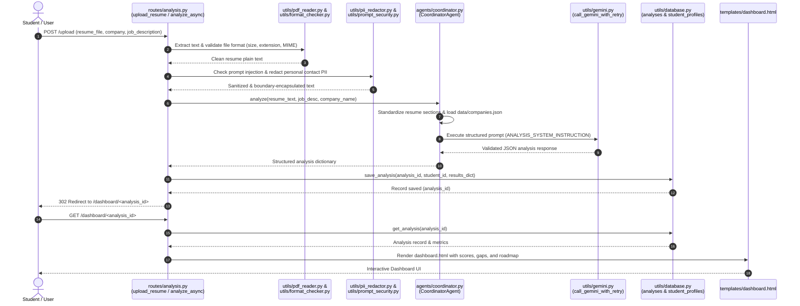
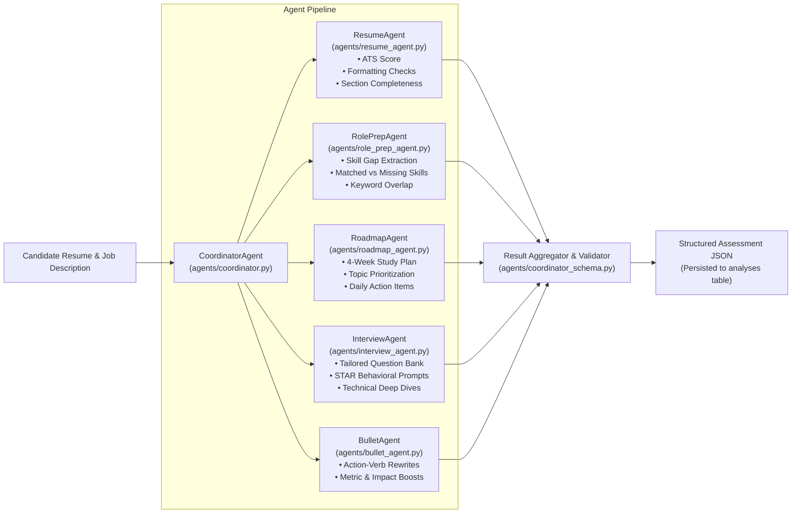
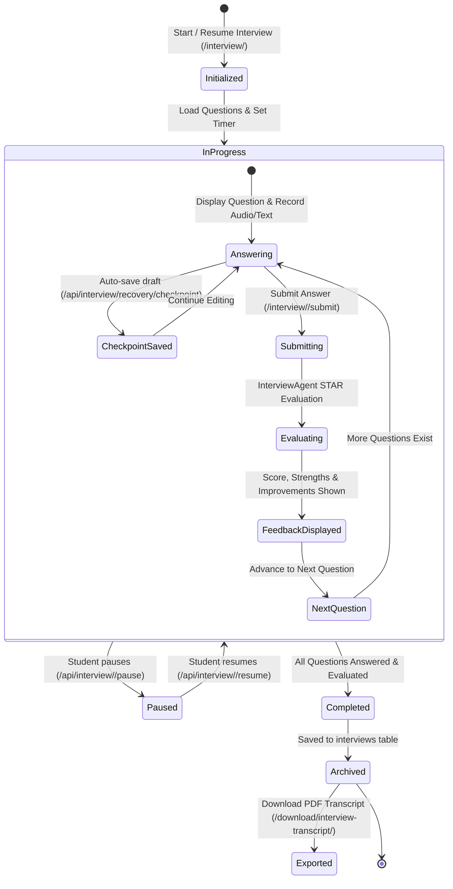
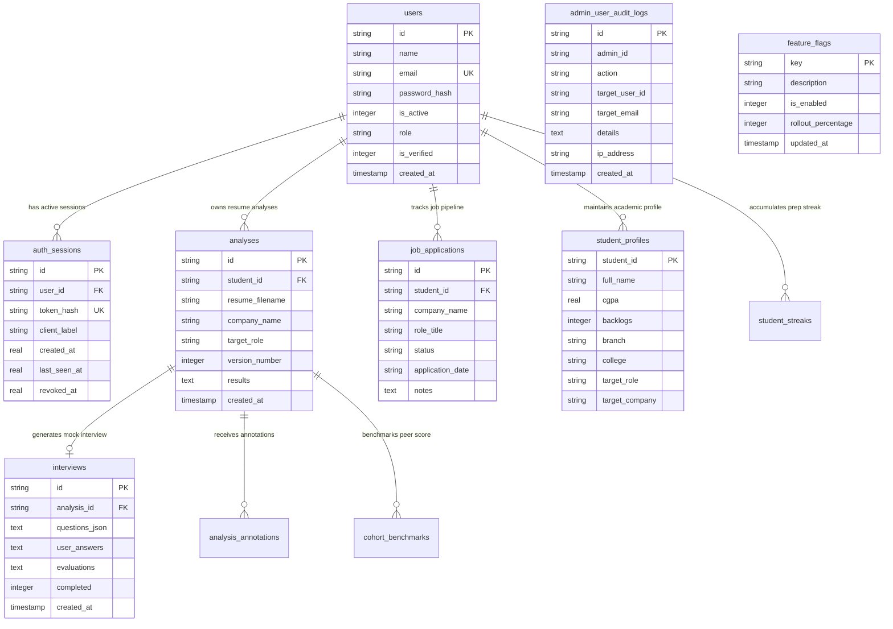

# AI Campus Placement Agent - Architecture & System Design

This document details the software architecture, data flow, multi-agent AI execution pipelines, interview session state machine, and core database schema of the **AI Campus Placement Agent**.

---

## 1. High-Level System Architecture

The application is structured into a modular Flask multi-blueprint service interacting with specialized AI agents, local SQLite persistence with migrations, and a responsive frontend template system.

---

## 2. Request Flow: Resume Analysis to Dashboard

When a student uploads a resume (PDF, DOCX, or plain text) along with a target company and job description, the system validates the input, extracts content, executes the coordinator agent, and persists the analysis.

---

## 3. The Agent Pipeline & Specialization

The platform uses a coordinated multi-agent model governed by `CoordinatorAgent`. Each agent handles a distinct dimension of candidate evaluation:

---

## 4. Mock Interview Session Lifecycle

Mock interviews allow students to test their readiness against company-tailored questions with real-time STAR evaluation and session resumption.

---

## 5. Main Database Tables & Schema Relationships

All application state is maintained in SQLite via `utils/database.py` and versioned migrations in `db/migrations.py`.

---

## 6. Directory Structure & Key Modules

| Path | Primary Responsibility |
| :--- | :--- |
| `app.py` | Application factory and server entrypoint (`create_app()`). |
| `routes/` | Modular Flask Blueprints: `auth.py`, `analysis.py`, `interview.py`, `tracker.py`, `admin.py`, `jobs.py`, `reports.py`. |
| `agents/` | Multi-agent AI core: `coordinator.py`, `resume_agent.py`, `interview_agent.py`, `coding_agent.py`, `roadmap_agent.py`. |
| `utils/` | Shared utilities: `gemini.py`, `database.py`, `feature_flags.py`, `pii_redactor.py`, `csrf.py`, `rate_limiter.py`. |
| `db/` | Database migration engine: `migrations.py` with versioned schema tracking. |
| `data/` | Static reference datasets: `companies.json`, `interview_questions.json`, `role_templates.json`, `schemas/`. |
| `templates/` | Jinja2 templates: `dashboard.html`, `interview.html`, `admin_users.html`, `admin_feature_flags.html`. |
| `static/` | Frontend assets: CSS, modular JavaScript (`static/js/modules/`), and icons. |
| `tests/` | Pytest automated test suites covering all routes, agents, schemas, and security controls. |
